# Passive High Voltage oscilloscope probe

> [!IMPORTANT]
> **UNTESTED.** This probe has not been built or measured yet. The voltage rating is a design target, and every performance figure below comes from simulation. Don't build it for real use until it has been tested.

A **1000:1 passive high-voltage probe** for a standard 1 MΩ oscilloscope input, designed for **up to 20 kV peak**. A compensated resistive/capacitive divider of 20 SMD segments is cast in polyurethane resin inside a grounded brass tube. The output is a BNC connector and a 1–3 m coax cable to the scope.

The design is backed by a set of [modelling tools](tools/README.md). They read the KiCad files directly and do the following:
- extract the parasitic capacitances with a 3D field solver;
- simulate the probe together with its cable and scope;
- size the compensation, design a graded divider, and map the electric-field stress.

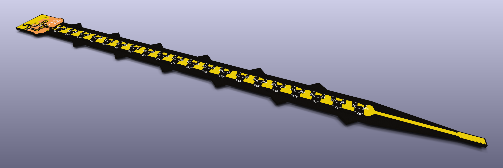

| | |
|---|---|
| Attenuation | 1000:1 into 1 MΩ |
| Max. voltage (design target) | 20 kV peak |
| Divider, high side | 20 × (2 MΩ ∥ (graded 270…47 pF + 33 Ω)) |
| Flatness after compensation | ≈ 3 % from 10 Hz to 1 MHz |
| Bandwidth | ≈ 36 MHz (−3 dB), 22 MHz (±1 dB) |
| Rise time / overshoot (1 ns edge) | 8.7 ns / 11 % |
| Input impedance (DUT loading) | 40 MΩ ∥ 20 pF |
| Shield | brass tube, 27.6 mm ID, end cap at the BNC end |
| Potting | Huntsman Arathane CW 5620 BLUE |
| Status | **not built** |

The performance figures are simulated for 1.5 m RG58, a scope input of 1 MΩ ∥ 15 pF, the 49.9 Ω back termination (R29) and an ideal source at the tip, with the resin as measured on a cast sample ([assumptions](#assumptions-and-limits)).

> [!NOTE]
> The PCBs for this project have been provided by [PCBWay](https://www.pcbway.com/).

The design is based on an [EEVblog video](https://www.youtube.com/watch?v=jUvSP3BQpvs). The electrical design is done in [KiCad](https://www.kicad.org/) 10 and the mechanical design in [onshape](https://www.onshape.com/en/).

## Contents

- [How the probe works](#how-the-probe-works)
- [Design](#design)
- [Simulation results](#simulation-results)
- [Building it](#building-it)
- [Calibration](#calibration)
- [Safety](#safety)
- [Repository layout and tools](#repository-layout-and-tools)
- [Previous revision](#previous-revision)

## How the probe works

The basic idea is a voltage divider: a large resistance from the input to the output, and a small one from the output to ground.

<p align="center">
  <picture>
    <source media="(prefers-color-scheme: dark)" srcset="images/schematics/divider-dark.svg">
    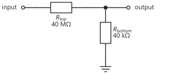
  </picture>
</p>

At high frequencies, every capacitance across the resistors and from the divider to its surroundings changes the division ratio. The resistors are therefore bypassed by capacitors, which take over at high frequency:

<p align="center">
  <picture>
    <source media="(prefers-color-scheme: dark)" srcset="images/schematics/divider-compensated-dark.svg">
    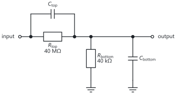
  </picture>
</p>

The divider is **compensated** when the top and bottom halves have the same time constant: R_top·C_top = R_bottom·C_bottom. The division ratio is then independent of frequency.

Here the top half is 20 segments of 2 MΩ in series (40 MΩ). Splitting it this way keeps each part at about 1 kV at 20 kV DC. The bottom half is:
- **Resistors:** 56 kΩ ∥ (56 kΩ + RV2). RV2 is a 1 MΩ 10-turn trimmer that sets the exact DC ratio together with the scope's 1 MΩ.
- **Capacitors:** the compensation capacitors C34, C35 and the 5.5–65 pF trimmer C13, plus the cable, the scope input and the TVS diode D1.
- **Output:** R29 (49.9 Ω) back-terminates the cable, and D1 protects the scope input.

### Why stray capacitance dominates this design

The divider sits on a board inside a grounded tube full of resin. Every node between two segments therefore has a capacitance to the shield, C<sub>s</sub> in the diagram:

<p align="center">
  <picture>
    <source media="(prefers-color-scheme: dark)" srcset="images/schematics/divider-ladder-dark.svg">
    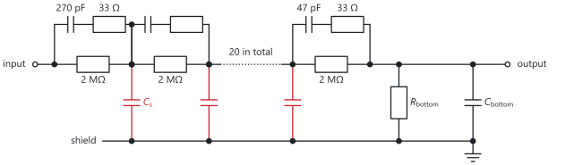
  </picture>
</p>

The field solver puts it at about **1.37 pF per node at 1 MHz, 26 pF in total**, and 1.64 pF (31 pF) at 1 kHz, where the resin's permittivity is higher. The 20 capacitors on the board in series give only 6.0 pF.

At high frequency these strays pull current to ground before it reaches the bottom of the divider. Two things follow:
1. **Compensation can't fix it.** The error has the wrong shape, a broad dip between ~100 Hz and ~100 kHz, not just the wrong size. No bottom capacitance removes it.
2. **Fast edges concentrate on the HV end.** With uniform 47 pF capacitors, the first segment would carry 3.1× its DC share of a fast edge.

The fix is a **graded divider**. The capacitors are largest at the HV end and smaller towards the bottom, sized so the extra current through each one feeds exactly the stray capacitance below it. The tools compute the grading from the extracted capacitances.

## Design

Files:
- schematic: [PDF](images/kicad/schematic.pdf), [SVG](images/kicad/schematic.svg), source in [`hv-probe-passive/`](hv-probe-passive/);
- board layout with the shield and resin outlines: [SVG](images/kicad/layout.svg);
- assembly drawings: [top](images/kicad/assembly-top.pdf), [bottom](images/kicad/assembly-bottom.pdf).


### Construction

- **PCB:** 2-layer, 1.6 mm FR4, 1 oz copper, all parts on the bottom side. Each divider step is connected by a copper pour that stays inside the outline of its pads, with filleted corners and solid pad connections (zones `s0`…`s20`, drawn by [`tools/make_pours.py`](tools/README.md#copper-pours-make_pourspy)). Soldermask is removed where the board is potted. Slots and notches in the outline lengthen the creepage paths and let the resin flow through.
- **Shield:** brass tube, 27.6 mm inner diameter, 1 mm wall. It's drawn in cross-section on the **User.1** layer, together with the **end cap** that closes the BNC end. The tube must be grounded.
- **Resin:** [Huntsman Arathane CW 5620 BLUE](https://products.huntsman.com/products/arathane-cw-5620-hy-5610), drawn on **User.2**. It fills the tube from the start of the divider, and its rounded body continues beyond the tube around the HV end. The LV end with the trimmer and RV2 stays accessible.
- **HV terminal:** a machined brass piece soldered onto the tapered tip of the board (see [Building it](#building-it)).

### Divider capacitors and damping

Each of the 20 segments is a 2 MΩ resistor in parallel with a C0G capacitor and its 33 Ω damping resistor. The capacitors are graded (E12 values, 3 kV, 1808):

| segment | C14 | C15 | C16 | C17 | C18 | C19 | C20 | C21 | C22 | C23 |
|---|---|---|---|---|---|---|---|---|---|---|
| **C** | 270p | 270p | 270p | 270p | 270p | 270p | 270p | 270p | 220p | 220p |

| segment | C24 | C25 | C26 | C27 | C28 | C29 | C30 | C31 | C32 | C33 |
|---|---|---|---|---|---|---|---|---|---|---|
| **C** | 180p | 150p | 120p | 120p | 100p | 68p | 68p | 56p | 47p | 47p |

- **The values come from the tools:** the grading that gives the flattest response for the stray capacitances of this layout ([how](tools/README.md#graded-divider-and-its-optimiser)).
- **Nothing is above 270 pF,** because larger values are hard to source in 3 kV C0G 1808 (`[optimize] cap_max` in [`tools/probe.toml`](tools/probe.toml)). An unlimited grading would run from 470 pF down. With the limit, the values at the HV end stop at 270 pF and the middle of the divider is larger instead. That costs no flatness, but fast edges are split less evenly between the segments (worst segment 1.43 times its share, against 1.32).
- **The list is one of several that are equally good.** Lists that differ by one E12 step in a few places reach the same error, and stay within 2.9–3.3 % if the real stray capacitances are up to 10 % larger than modelled.
- **33 Ω per capacitor (R30–R49)** damps the ringing of the divider's own inductance; see [Damping](#damping).
- **Bottom capacitance:** C34 + C35 = 2.7 nF + 270 pF, for 1.5 m of RG58. Other cable lengths need other values; see [the table](#compensation-capacitor-per-cable-length).
- **Part tolerances barely touch the flatness, but they move the bottom capacitance.** With the tolerances of the parts chosen (1 to 10 %), 9 builds in 10 stay below 3.1 %. The bottom capacitance they need differs by about ±100 pF, more than the trimmer's ±30 pF, so expect to select C35 on the finished probe.

To recompute after any change: `python tools/run_all.py`, or for the response alone `python tools/probe_sim.py response --optimize` (add `--seg-r 22` to try another damping resistor).

### Bill of materials

| Reference | Qty | Value | Part |
|---|---|---|---|
| R7–R26 | 20 | 2 MΩ, 2512 | HV121WF2004T4E |
| C14–C21 | 8 | 270 pF C0G, 1808, 3 kV | 1808N271J302CT |
| C22, C23 | 2 | 220 pF C0G, 1808, 3 kV | 1808N221K302CT |
| C24 | 1 | 180 pF C0G, 1808, 3 kV | C1808C181FHGACAUTO |
| C25 | 1 | 150 pF C0G, 1808, 3 kV | 1808N151K302CT |
| C26, C27 | 2 | 120 pF C0G, 1808, 3 kV | 1808N121J302CT |
| C28 | 1 | 100 pF C0G, 1808, 3 kV | CC1808KKNPOEBN101 |
| C29, C30 | 2 | 68 pF C0G, 1808, 3 kV | 1808N680J302CT |
| C31 | 1 | 56 pF C0G, 1808 | 1808J5K00560KCT |
| C32, C33 | 2 | 47 pF C0G, 1808, 3 kV | FV42N470J302ECG |
| R30–R49 | 20 | 33 Ω, 1206 (damping) | CRCW120633R0JNEAHP |
| C34 | 1 | 2.7 nF C0G, 1206 | FM31N272J251EEG |
| C35 | 1 | 270 pF C0G, 1206 | CC1206JKNPOCBN271 |
| C13 | 1 | 5.5–65 pF trimmer | BFC280832659 |
| RV2 | 1 | 1 MΩ 10-turn | 3296X-1-105LF |
| R27, R28 | 2 | 56 kΩ, 0805 | 0805W8F5602T5E |
| R29 | 1 | 49.9 Ω, 0805 (back termination) | 0805W8F499JT5E |
| D1 | 1 | bidirectional TVS, ≈ 20 pF | H36VND3B |
| J2 | 1 | BNC, horizontal | Amphenol B6252HB-NPP3G-50 |
| – | – | resin, brass tube and end cap, 3D-printed mold | |

The schematic carries the supplier numbers for each part.

## Simulation results

All figures come from the [tools](tools/README.md) run on the current KiCad files; outputs are in [`tools/results/`](tools/results/). They predict an untested design: treat them as engineering estimates, not specifications.

### Extracted parasitics

| | value at 1 kHz |
|---|---|
| each divider node → shield | 1.62–1.71 pF (31.1 pF in total) |
| across each segment, parallel to its capacitor | 0.44–0.47 pF |
| HV tip → ground | 3.7 pF |
| divider bottom → ground | 4.3 pF |

These are evaluated at 1 kHz, where the resin's εr is 5.2. At 1 MHz (εr = 4.25) the node-to-shield total is 26.0 pF, at 10 Hz (εr = 6.5) it is 38.0 pF. A node comprises its two resistor pads, its capacitor and damping-resistor pads, the pour that joins them, and the pads between the next damping resistor and its capacitor. [Full table](tools/results/capacitance_summary.txt) · [how the board was imported](tools/results/model_check.png).

### Frequency and step response

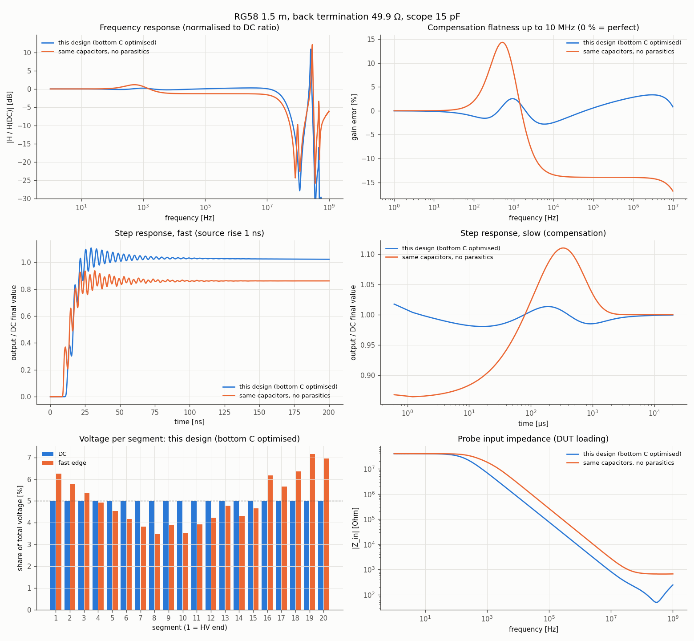

| (1.5 m RG58) | value |
|---|---|
| gain error, 10 Hz – 1 MHz | ≈ 2.8 % |
| −3 dB / ±1 dB bandwidth | 36 MHz / 22 MHz |
| rise time / overshoot (1 ns edge) | 8.7 ns / 11 % |
| input capacitance | 20.1 pF |
| fast-edge voltage per segment | 0.70…1.43 × its DC share (max ≈ 1.43 kV at 20 kV) |

**The remaining 3 % is the resin.** Its permittivity falls from 6.5 at 10 Hz to 4.25 at 1 MHz, spread evenly over the whole band, and the stray capacitances follow it while the C0G capacitors do not. The error is +2.5 % near 900 Hz, −2.8 % near 6 kHz and back to +2.8 % at 1 MHz; no fixed set of capacitors and no bottom capacitance removes it. Getting below 3 % needs a potting compound with a loss tangent near 0.01 instead of 0.04–0.08, or a divider with less stray capacitance per node.

#### Damping

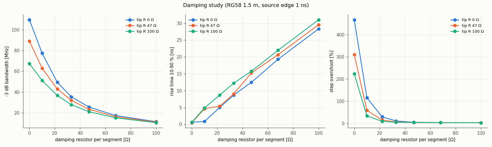

| resistor per capacitor | −3 dB | ±1 dB | rise | overshoot |
|---|---|---|---|---|
| 10 Ω | 78 MHz | 60 MHz | 0.9 ns | 115 % |
| 22 Ω | 49 MHz | 34 MHz | 5.0 ns | 29 % |
| **33 Ω (fitted)** | **36 MHz** | **22 MHz** | **8.7 ns** | **11 %** |
| 47 Ω | 26 MHz | 15 MHz | 12.5 ns | 5 % |
| 68 Ω | 18 MHz | 10 MHz | 19.3 ns | 3 % |

The fast current runs the 10.9 mm pitch of each segment with its return on the tube wall. That is about 6 nH per segment, 122 nH along the divider, plus about 45 nH for the strip to the tip: the divider behaves as an LC ladder of about 70 Ω, 1.8 ns long, and rings unless it is damped to match. A resistor at the tip also damps (47 Ω there with the 33 Ω fitted: 6 % overshoot, 32 MHz), but costs more bandwidth for the same damping.

These figures are for an ideal source at the tip and depend on inductances estimated from the geometry (±30 %), so check the step response of an assembled board in its tube before potting it. The lead and ground return to the circuit under test add about 1 nH per mm and will usually dominate; set `source_l` in [`tools/probe.toml`](tools/probe.toml) to see their effect. Above ~100 MHz the model is qualitative.

#### Divider options compared

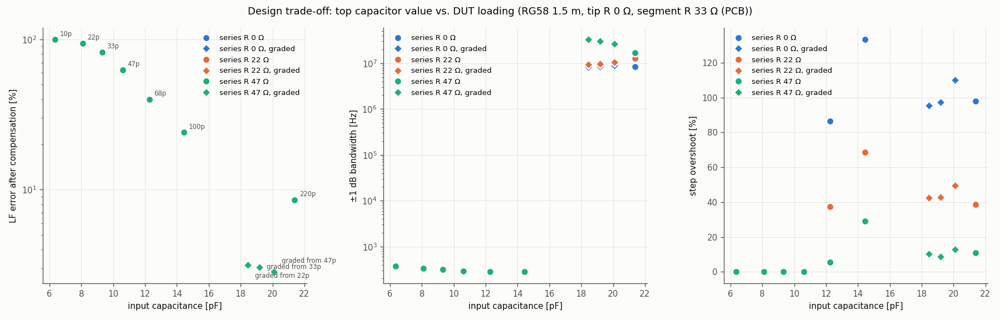

- **Uniform capacitors** do not work in this tube: 220 pF in every segment still leaves 8.6 % error, at 21 pF input capacitance.
- **Grading** reaches 2.8–3.2 % at 18.5–20.1 pF.
- **Grading from 22 or 33 pF** at the bottom instead of 47 pF would load the DUT a little less (18.5 / 19.2 pF) for 3.2 / 3.1 % error, and need less bottom capacitance (1.2 / 2.0 nF).

### Compensation capacitor per cable length

The cable's capacitance (~100 pF/m) is part of the bottom capacitance, and the trimmer only covers ±1 % of it. **So the fixed capacitors have to match the cable you'll use.**

| RG58 length | C34 + C35 + C13 | e.g. |
|---|---|---|
| 1 m | 3.06 nF | 2.7 nF + 330 pF, trimmer ≈ 30 pF |
| **1.5 m (fitted)** | 3.01 nF | 2.7 nF + 270 pF, trimmer ≈ 40 pF |
| 2 m | 2.96 nF | 2.7 nF + 220 pF, trimmer ≈ 40 pF |
| 3 m | 2.86 nF | 2.7 nF + 120 pF, trimmer ≈ 40 pF |

These assume a 15 pF scope input and 20 pF for D1. `python tools/probe_sim.py optimize` recomputes them; use `--c-scope` and `--length` for your setup.

### Electric-field stress

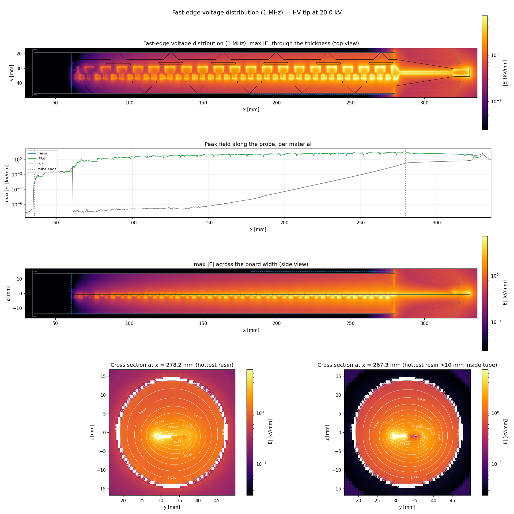

At 20 kV, with the divider compensated, the highest fields are at the HV end of the divider, at the edge of the HV pour that faces the tube wall just inside the tube mouth (x ≈ 278 mm):

| | peak at copper edges | bulk | short-term strength |
|---|---|---|---|
| resin | 10.7 kV/mm | 8.3 kV/mm | 25 kV/mm |
| FR4 | 11.1 kV/mm | 7.9 kV/mm | ~20 kV/mm |
| along the board surface (tangential) | 7.5 kV/mm | | |

- **The HV pour is larger than its pads, and the strip to the tip is 2.5 mm wide.** The first resistor and damping resistor sit in the tube mouth. A pour flush with their pads and a 1 mm strip would put 10.7 kV/mm into the resin at the end of the damping resistor. Growing the pour by 1 mm towards the tip and the tube wall brings that to 8.4 kV/mm on the same grid, for 0.3 pF more input capacitance ([tools README](tools/README.md#copper-pours-make_pourspy)).
- **Along the divider** the pours that connect each step lower the resin field by about 10 % against bare pads, because they remove the gaps between the pads, for 5 % more capacitance to the shield. They stay inside the pads' outline, so the copper comes no closer to the shield or to the next step than the pads do (2.42 mm between adjacent steps).
- **The exposed tip in air** reaches ≈ 6.5 kV/mm in the model, above the ~3 kV/mm at which air breaks down. The brass terminal there must have large, smooth radii, and the real value depends on its shape and on the surroundings.

#### Reading the stress numbers

The "short-term strength" column is the datasheet breakdown of a thick, void-free sample, so comparing with it says little about whether the probe will last. What limits a potted HV part is **partial discharge (PD)**: small discharges in gas voids, along delaminated interfaces or at sharp edges. Each one is harmless, but repeated discharges erode the resin until it fails, sometimes after hours, sometimes after years.

- **Voids see more field than the resin around them.** The field in a gas void is εr times the resin field for a thin, flat void across the field, and 3εr/(2εr + 1) ≈ 1.3–1.4 times for a round one. Air in a 0.1 mm gap breaks down at about 8–9 kV/mm, and in a 50 µm gap at about 11 kV/mm. At the predicted bulk field of ~8.3 kV/mm, **any void of ~50–100 µm or larger near the HV end of the divider will discharge**, and a flat one far smaller. The casting has to be void-free there: degas the resin, cast under vacuum if possible, and pour slowly from the bottom.
- **Interfaces are weaker than the bulk.** The board surface sees 7.5 kV/mm along it, at the FR4–resin interface. Flux residue, moisture or poor adhesion turns that interface into a discharge or tracking path. Clean and dry the board before casting.
- **The copper-edge "peak" values are lower bounds.** A 35 µm copper edge has a radius of tens of µm, and the real field there is much higher than any grid cell can show. It is also where resin most easily fails to wet or pulls away from the board.
- **DC is different.** At DC the field between the materials divides by their conductivity, not their permittivity, and that isn't modelled. The DC map shows the distribution just after the voltage is applied. Under steady DC, discharges in voids are much rarer than under AC or repeated pulses.
- **Design target.** Cast-resin HV designs typically keep the working stress at a few kV/mm. The ~8.3 kV/mm here is acceptable only for short exposures and a void-free casting. Lowering it further (a flared or rolled tube rim, a tube that ends a few mm earlier, more distance between the first parts and the tube mouth) adds real margin. A partial-discharge test at above the working voltage is the only way to know. Even without a PD meter, discharges show up as small spikes on the probe output while a slowly rising DC or a 50 Hz voltage is applied.

### Where should the tube end?

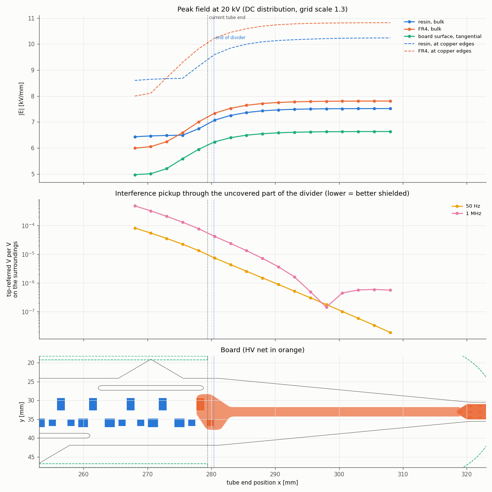

Extending the tube past the divider doesn't lower the stress; it raises it. Over the bare HV conductor, the tube forms a coax with the full 20 kV between the inner conductor and nearby ground.

The shielding, meanwhile, improves exponentially with tube length (about 1.6× per 2.5 mm), so a tube that ends at the divider is already plenty:

| tube end | bulk stress (resin) | pickup at 1 MHz, tip-referred |
|---|---|---|
| 268 mm (12 mm before the end of the divider) | 6.4 kV/mm | 0.49 mV per V on the surroundings |
| 273 mm | 6.5 kV/mm | 0.21 mV/V |
| 278 mm | 6.7 kV/mm | 0.08 mV/V |
| **279.4 mm (current)** | ≈ 6.9 kV/mm | ≈ 0.055 mV/V |
| 283 mm | 7.3 kV/mm | 0.024 mV/V |
| 290.5 mm | 7.5 kV/mm | 0.004 mV/V |

The current row is interpolated between the swept positions. The sweep runs on a coarser grid (scale 1.3) than the stress table above, so compare its rows with each other, not with that table.

**The tube ends at 279.4 mm**, 1 mm short of the last divider pads (280.4 mm). Even there, 1 kV of nearby 1 MHz interference looks like 55 mV at the tip. Ending it 6 mm earlier (273 mm) would lower the bulk stress by about 6 % for 4× more pickup, which is still small; past 285 mm nothing is gained and the stress is 6–9 % higher. A larger gain would need a rounded or flared tube rim.

### Assumptions and limits

- **Resin dielectric.** A cast sample was measured on an RLC bridge from 20 Hz to 200 kHz and corrected with a C0G reference capacitor; 200 Hz–120 kHz is usable and consistent with Kramers–Kronig. The model is a Cole–Cole relaxation fitted to it ([tools README](tools/README.md#resin-measurement)): εr = 6.0 at 50 Hz, 5.2 at 1 kHz, 4.4 at 100 kHz and 4.25 at 1 MHz, with tanδ falling from 0.078 to 0.025. Three things are still open:
  - **the scale.** The sample is an uneven layer, 1 to 4 mm thick, so the datasheet's εr = 6 at 50 Hz fixes the scale. The sample's dimensions agree with that within about 10 %. Its shape over frequency and its loss do not depend on the thickness;
  - **air under the foil electrodes.** There are signs of some. It would mean the true loss and dispersion are about 30 % larger than read (εr = 3.8 at 1 MHz). The sample's dimensions lean against it without excluding it. The best capacitor list would differ in one value by one step (C31), and with the list as fitted the remaining error would be 3.4 % instead of 2.8 %;
  - **above 120 kHz** the model is an extrapolation. The bandwidth figures rest on it.

  Thickness readings at a dozen points under the electrodes, or a flat sample, would settle the first two; a VNA sweep of the sample to 100 MHz the third. No new field solve is needed.
- **Inductance.** Each segment's series inductance and the tip strip's are estimated from the geometry (6 nH and 45 nH), without magnetic coupling between segments. They set the overshoot and the damping needed, and are good to perhaps ±30 %. The overshoot also depends on the inductance of the bottom capacitors C34 and C35, taken as 0.74 nH each: 4 % with half of that, 23 % with twice.
- **Validity.** The circuit model is quasi-static and lumped: right in shape to ~100 MHz, qualitative above.
- **Field solver.** With grid lines on the pad edges, nominally identical steps agree within 1.5 % (most within 0.2 %) and the capacitances change by 2 % between the two finest grids that fit this machine; they are probably still a few percent low. The circuit model's scaling of the parasitics with permittivity is within 0.4 % of direct field solves over 10 Hz–100 MHz.
- **Checks.** The circuit model matches LTspice to 0.001 dB below 1 MHz and 0.05 dB at 30 MHz on the same netlist.
- **Not modelled:** the brass tip terminal, the input fuse, the connection to the circuit under test, part bodies (treated as resin), voids in the potting.

## Building it

### PCB

The board is a simple two-layer design:
- **Soldermask** is removed where the board will be potted. The part with soldermask stays outside the resin, so the compensation trimmer and RV2 can be adjusted afterwards.
- **A ground pad** is exposed for connecting the shield and end cap.

At the HV end, a large exposed copper area sits far from the shield to increase creepage distance. This tapered end sticks out of the tube and is cast in resin, preferably ribbed for even more creepage.

Before casting:
- **Machine a brass piece** that fits over the straight tip of the tapered end, with a female thread at its end. A screw threaded into it makes the HV contact.
- **Solder it to the tip.** Give it large, smooth radii (see [stress](#electric-field-stress)).

**Never apply excessive force** to the terminal relative to the probe body. The exposed part can be shaped to take a wrench, so you can hold the terminal while fastening an attachment. Tighten finger-tight only.

### Components

- **All divider capacitors must be C0G/NP0.** Class II dielectrics (X7R and similar) lose much of their capacitance under DC bias and with temperature, which would ruin the compensation.
- **The HV resistors** are 2512 high-voltage types.
- **Clean the board thoroughly** before casting; flux residue under the resin is a long-term breakdown path.

### Casting in resin

A 3D-printable mold has been designed in [onshape](https://cad.onshape.com/documents/634b2c7804eb6959816cbee4/w/1f30c7d8f223e5e8fad3fc6d/e/e251d38d61b503254921d7bb) (STL and PDF in [`mold/`](mold/)).

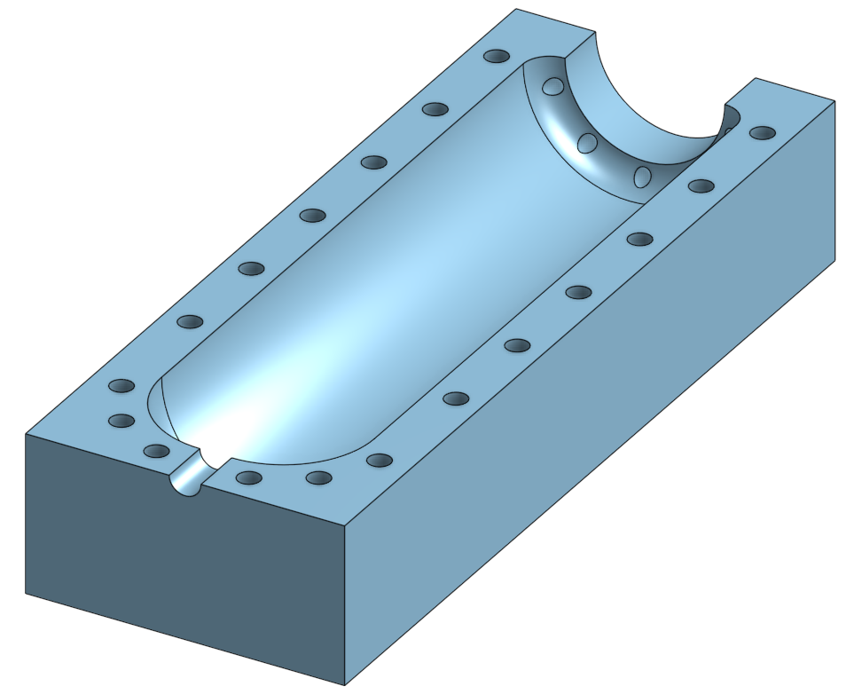

- **Mold material:** PETG releases well from the resin. The two halves are held together by 18 M4 × 70 mm bolts, and wax works as a release agent.
- **Pouring:** pour the resin into the metal tube with the tip of the probe facing down. Fill until it reaches the 3 mm vent holes at the top.
- **No bubbles:** degas the resin; trapped air is where breakdown starts.

## Calibration

Always calibrate with the cable and scope you'll use:

1. Fit C34 + C35 for your cable length (table above, or `probe_sim.py optimize`).
2. Set RV2 to about 110 kΩ, which gives 1000:1 into 1 MΩ (`probe_sim.py info` prints the exact value). Then trim RV2 for exactly 1000:1 with a known DC or low-frequency voltage.
3. Apply a square wave of a few hundred Hz to a few kHz and adjust C13 for the flattest top.
4. Check the response at several frequencies and with a fast edge.

## Safety

> [!CAUTION]
> High voltage can easily be lethal. Only work with it if you are qualified. You build and use this project at your own risk. This is experimental high-voltage equipment.

1. Don't use the probe on energized equipment unless you are qualified to work with high voltage.
2. 20 kV is a design target, not a verified rating.
3. Never rely on the probe alone for isolation.
4. Use a current-limited HV source for testing.
5. Make sure the oscilloscope and everything connected to it are rated appropriately. The scope ground is tied to mains protective earth and must stay that way during measurements. Remote control of the scope is recommended.
6. The shield must be properly grounded.
7. Inspect the probe for damage before every use.
8. Don't use a probe that has had an internal arc-over.
9. Potting makes internal faults hard or impossible to inspect.
10. Fast edges stress the divider unevenly (see [simulation](#frequency-and-step-response)); derate for pulsed or switching measurements.

The final breakdown voltage depends on the craftsmanship: the resin, the cleanliness of the parts when cast, and above all **no trapped air bubbles**. Keep a generous safety margin.

### Internal arc-over protection

For extra safety, put a **fuse in series with the probe input**. An internal arc-over would draw large current from a DUT that can supply it. Sustained arcing inside a hard-potted body can build pressure, and in an extreme case the probe could burst.

Microwave-oven fuses are the highest-voltage fuses that are cheaply available. Lower-current fuses would be better, but they are only rated to about 250 VAC.

**If the fuse ever blows, mark the probe as faulty and stop using it.**

## Repository layout and tools

| path | contents |
|---|---|
| [`hv-probe-passive/`](hv-probe-passive/) | KiCad project (schematic, PCB) |
| [`tools/`](tools/README.md) | field solver, circuit simulator, design scripts, [results](tools/results/) |
| [`images/kicad/`](images/kicad/) | renders and drawings generated from the KiCad files |
| [`images/schematics/`](images/schematics/) | the circuit diagrams of this page, drawn by `tools/draw_schematics.py` |
| [`mold/`](mold/) | casting mold (STL, drawing) |
| [`images/previous-revision/`](images/previous-revision/) | images of the through-hole revision |

After changing the design:

```
cd tools
python make_pours.py       # only after moving divider parts: redraw the copper pours, refill the zones (KiCad closed)
python run_all.py          # re-run all analyses (~15 min; --quick for a coarse check)
python render_kicad.py     # regenerate the images in images/kicad/
python draw_schematics.py  # redraw the circuit diagrams with the values on the board
```

## Previous revision

The first revision used five 10 MΩ axial HV resistors with 22 pF disc capacitors. I had it manufactured by PCBWay: I uploaded the gerbers, placed a quick order, and the five boards arrived within a couple of days. The packing and the board quality were excellent.

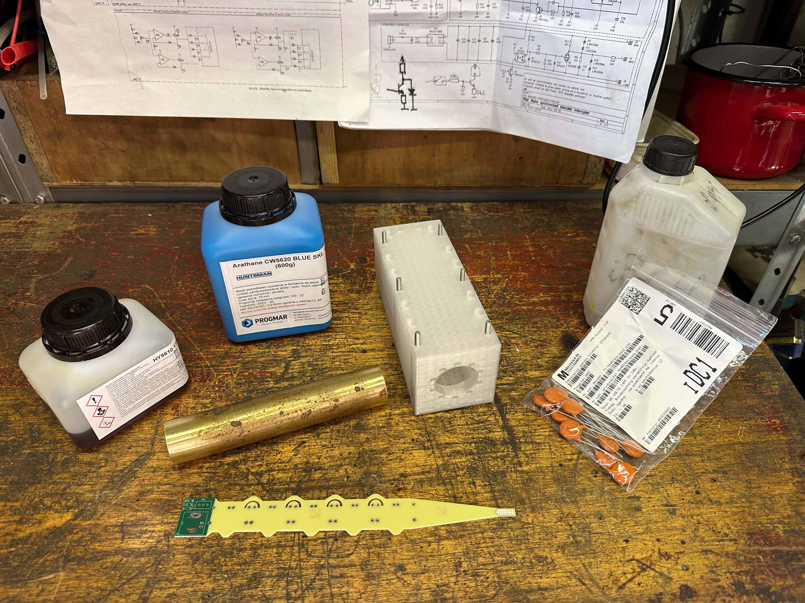

Its renders, assembly and dimension drawings are in [`images/previous-revision/`](images/previous-revision/), and its gerbers and BOM are in `hv-probe-passive/production/`. At the time, one probe cost about 99 USD in parts, without shipping: PCB 4.2, capacitors 32.8, BNC 8.2, resistors 7.1, trimmer 2.5, resin 25, tube 17, filament 2. The PCBs, the resin and the tube only come in larger quantities than one probe needs.
